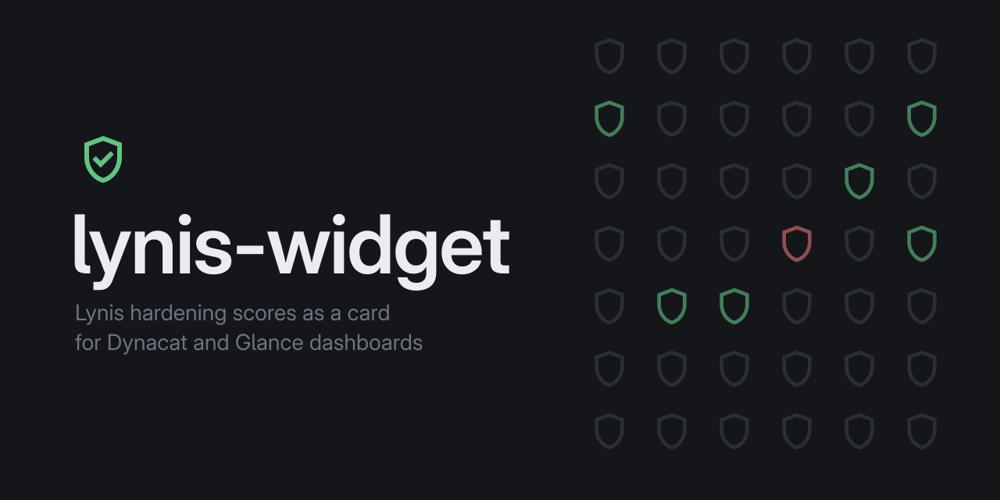
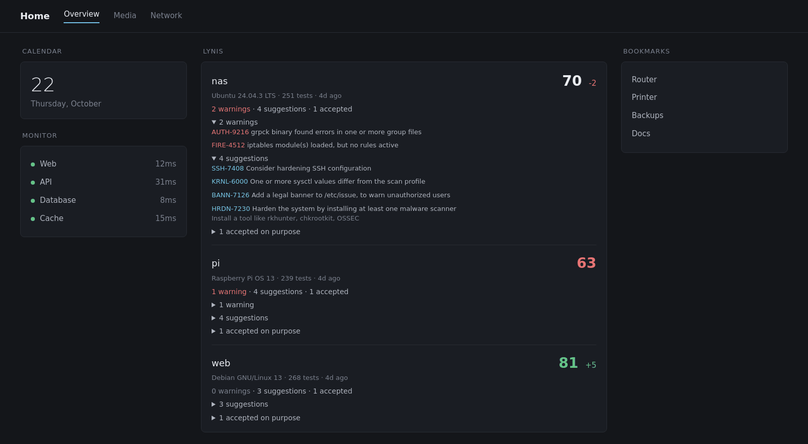
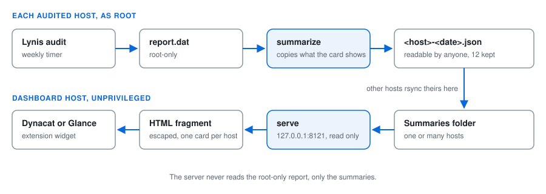

<p align="center"></p>

[](https://github.com/zakijss/lynis-widget/actions/workflows/ci.yml)
[](https://github.com/zakijss/lynis-widget/releases)
[](LICENSE)

# lynis-widget

Your [Lynis](https://cisofy.com/lynis/) results on your dashboard. It is an
extension widget for [Dynacat](https://github.com/panonim/dynacat) and
[Glance](https://github.com/glanceapp/glance): one card per host with the
hardening index, how it moved since the last run, and the warnings and
suggestions Lynis found, each with the fix Lynis suggests.



It is one Python file with no dependencies beyond the standard library.

## How it works



Lynis writes a detailed report to `/var/log/lynis-report.dat`, readable by root
only. `lynis_widget.py summarize`, run as root after each audit, copies the
parts the widget shows into a small JSON file that any user can read:

- the hardening index, test count, OS and Lynis version;
- each warning and suggestion: test ID, text, details and Lynis's suggested fix;
- the tests your profile skips on purpose, with the comment above each
  `skip-test=` line as the reason.

Nothing else from the report is copied. `lynis_widget.py serve` then answers
the dashboard with an HTML fragment built from those summaries. It runs as an
unprivileged user and only reads.

Summaries from several hosts can share one folder (see
[Several hosts](#several-hosts)).

## Requirements

- Lynis 3.x on each host you audit, from your distribution's package
  (`apt install lynis`, `dnf install lynis`, `zypper install lynis` and so
  on) or a clone of [CISOfy/lynis](https://github.com/CISOfy/lynis).
- Python 3.10 or newer, and systemd for the example units.
- Dynacat, or Glance 0.7 or newer, with `allow-potentially-dangerous-html`
  allowed for this widget. Everything the widget prints from a report is
  HTML-escaped first.

## Quick start

On each host to audit, as root:

```bash
install -m 755 lynis_widget.py /usr/local/bin/
lynis audit system --quiet
lynis_widget.py summarize            # writes /var/lib/lynis-widget/<host>-<date>.json
```

On the dashboard host (it can be the same one):

```bash
install -m 755 lynis_widget.py /usr/local/bin/
install -m 644 deploy/lynis-widget.service /etc/systemd/system/
systemctl daemon-reload
systemctl enable --now lynis-widget.service
curl -s -D - http://127.0.0.1:8121/ | head    # Widget-Title: Lynis
```

Then add the widget to a page in `dynacat.yml` (or `glance.yml`), as in
`deploy/dynacat.yml`:

```yaml
- type: extension
  url: http://127.0.0.1:8121/
  allow-potentially-dangerous-html: true
  cache: 5m
```

If the dashboard runs in a container, `127.0.0.1` is the container itself,
and the server bound to the host's `127.0.0.1` is out of its reach. Either run
the dashboard with host networking (`--network host`), or bind the server to
an address the container can reach, such as Docker's bridge (`--bind
172.17.0.1`, then `url: http://host.docker.internal:8121/` with
`--add-host=host.docker.internal:host-gateway`), and set a token (see
[Security](#security)). Rootless Podman with
`--network slirp4netns:allow_host_loopback=true` reaches the host's
`127.0.0.1` as `10.0.2.2`.

The server can also run in rootless Podman in place of
`lynis-widget.service`: `deploy/lynis-widget.container` is a Quadlet that runs
the stock Python image with the script and the summaries mounted read-only.
The audit can't move into a container, because Lynis has to read the whole
host as root.

```bash
mkdir -p ~/lynis-widget ~/.config/containers/systemd
cp lynis_widget.py ~/lynis-widget/
cp deploy/lynis-widget.container ~/.config/containers/systemd/
systemctl --user daemon-reload && systemctl --user start lynis-widget.service
curl -s -D - http://127.0.0.1:8121/ | head    # Widget-Title: Lynis
```

On SELinux hosts, label the summaries' folder for containers once, as root
(new summaries inherit it): `chcon -R -t container_file_t /var/lib/lynis-widget`.

To audit weekly, as root on each host:

```bash
install -m 644 deploy/lynis-audit.service deploy/lynis-audit.timer /etc/systemd/system/
systemctl daemon-reload
systemctl enable --now lynis-audit.timer
```

It runs Lynis on Sunday nights and writes the summary straight after. If you
already run Lynis from cron or your own unit, install
`deploy/lynis-widget-summarize.service` instead and start it after each run.

Paths are set in the units. If Lynis writes its report somewhere else
(`lynis --report-file`), or the script lives outside `/usr/local/bin`, edit
the `ExecStart` lines; `systemctl edit` keeps the change in an override file.

## Commands

```text
lynis_widget.py summarize [--report FILE] [--profile FILE] [--lynis-dir DIR]
                          [--host NAME] [--out DIR] [--keep N]
lynis_widget.py serve [--dir DIR] [--bind ADDR] [--port N] [--title TEXT] [--link URL]
lynis_widget.py --self-test
```

| Option | Default | What it is |
|---|---|---|
| `--report` | `/var/log/lynis-report.dat` | the report to summarise |
| `--profile` | `/etc/lynis/custom.prf` | a profile whose `skip-test=` lines are the accepted tests |
| `--lynis-dir` | found in the usual places | Lynis's install folder, for each test's category and description |
| `--host` | this machine's short hostname | the name on the card |
| `--out` | `/var/lib/lynis-widget` | where summaries are written |
| `--keep` | `12` | summaries kept per host |
| `--dir` | `/var/lib/lynis-widget` | the folder `serve` reads |
| `--bind`, `--port` | `127.0.0.1`, `8121` | where `serve` listens |
| `--title` | `Lynis` | the widget's title |
| `--link` | none | a page the title opens, such as a fuller report |

`serve` also reads `LYNIS_WIDGET_DIR`, `LYNIS_WIDGET_BIND`,
`LYNIS_WIDGET_PORT`, `LYNIS_WIDGET_TITLE` and `LYNIS_WIDGET_LINK`, which are
easier to set in a systemd unit or container.

## Several hosts

`serve` reads every `*.json` under its folder, subfolders included, and takes
each host's name from the `host` field inside the file, so the file names and
the layout are up to you. A flat folder of `<host>-<date>.json` files, as
`summarize` writes them, works; so does one subfolder per host. For each host
it shows the newest summary and the change from the one before it.

One way to collect them is a cron job or timer on each audited host that pushes
its summaries to the dashboard host:

```bash
rsync -a /var/lib/lynis-widget/ dashboard:/var/lib/lynis-widget/
```

`summarize` keeps the newest `--keep` files per host in its own `--out` folder
and leaves other hosts' files alone, so pushing into a shared folder is safe.

## Security

The server listens on `127.0.0.1` unless you tell it otherwise. If it has to
listen on a network, set `LYNIS_WIDGET_TOKEN` and send the same token from the
dashboard:

```yaml
- type: extension
  url: http://dashboard.example.com:8121/
  allow-potentially-dangerous-html: true
  headers:
    Authorization: Bearer your-token-here
```

A summary lists what Lynis thinks is weak on a host. Treat the folder and the
widget as you would the report: keep them off the internet.

## The cards

Each card shows the host, its hardening index out of 100 (green from 80,
neutral from 65, red below), the change since the previous run, the OS, the
number of tests and how long ago the audit ran. Warnings, suggestions and
accepted tests open as lists. `/health` answers `ok` for monitoring.

## Checks

```bash
python3 lynis_widget.py --self-test
```

It covers report parsing, the accepted-tests profile, summary rotation (and
that one host's rotation leaves a similarly named host's files alone),
summaries in subfolders, the multi-host view with its change, and HTML escaping
of hostile report text.

## Licence

MIT. Lynis is a CISOfy project under the GPL; this widget only reads the report
it writes.

The shield icons in the banner (docs/banner.svg) are "shield" and
"verified_user" from Google's
[Material Symbols](https://github.com/google/material-design-icons), licensed
under the Apache License 2.0; the full text is in
[LICENSE-Apache-2.0.txt](LICENSE-Apache-2.0.txt).
